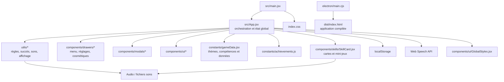

# Registre de dette technique — CodeWash

**État de référence :** 16 novembre 2026
**Périmètre observé :** application React/Vite et son lanceur Electron, dans `CodeWashGame/CodeWashGame/`.
**État des travaux :** aucun refactoring applicatif n’a été effectué pour établir ce registre.

Ce registre décrit les dettes visibles dans le code et les écarts par rapport au protocole du sujet CodeWash. Les risques et estimations sont des évaluations initiales à confirmer avec l’équipe. Les mesures non exécutées sont signalées comme telles plutôt que supposées.

## 1. Cartographie de l’application

### Responsabilités et frontières observées

| Zone | Responsabilité actuelle |
|---|---|
| `src/App.jsx` | État du joueur et des profils, chargement/sauvegarde, progression, combats, succès, thèmes, événements, reconnaissance vocale et composition de l’interface. |
| `src/components/skills/SkillCard.jsx` | Présentation des compétences et logique interactive des jeux de mémoire, Simon, lecture, écriture, mathématiques et nettoyage. |
| `src/constants/gameData.jsx`, `src/constants/achievements.js` | Données des compétences, thèmes, contenus, ennemis, objets et succès. |
| `src/utils/gameUtils.js`, `achievementUtils.js`, `mobDisplayUtils.js` | Règles de jeu, progression et présentation de données. |
| `src/utils/soundManager.js` | Création et lecture des sons et gestion de la musique de fond. |
| `src/components/ui/GlobalStyles.jsx`, `src/index.css` | Styles globaux et animations. |
| `electron/main.cjs` | Création de la fenêtre Electron et chargement du build Vite. |

### État et entrées/sorties

- **État React partagé :** principalement dans `App.jsx` (profil courant, statistiques, compétences, thème, combat, challenge, volumes, état du micro et des panneaux). L’état temporaire des mini-jeux est dans `SkillCard.jsx`.
- **Stockage persistant :** `localStorage`, chargé et écrit directement par `App.jsx`; `PhantomEvent.jsx` y stocke aussi son délai de réapparition. Les clés de sauvegarde sont versionnées dans leur nom, mais aucun schéma de sauvegarde central n’est défini.
- **Audio :** API `Audio` directement appelée par le gestionnaire de sons et les mini-jeux.
- **Reconnaissance vocale :** `window.webkitSpeechRecognition` directement utilisée par `App.jsx`.
- **Navigateur/OS :** API plein écran du DOM et autorisation d’accès au microphone.
- **Réseau :** aucun transport de rapport de bogue n’est configuré dans le flux observé; la fenêtre de rapport est actuellement une simple présentation.

## 2. Registre des dettes

Les priorités sont définies ainsi : **P0** = prérequis bloquant avant refactoring, **P1** = risque élevé ou fonctionnalité importante, **P2** = amélioration à planifier. Les efforts sont des tailles indicatives : **S** (≤ 1 jour), **M** (2–5 jours), **L** (> 5 jours), à valider après découpage en tâches.

| ID | Emplacement | Problème / odeur | Impact et risque | Effort | Priorité | Statut |
|---|---|---|---|---|---|---|
| DEBT-01 | `CodeWashGame/CodeWashGame/package.json`; `.github/workflows/build-exe.yml` | Pas de suite de tests ni de commande de test/coverage. Le workflow ne s’exécute que sur `push` vers `main` ou déclenchement manuel; il ne vérifie pas les PR, les tests, le formatage, les seuils de couverture ou l’analyse statique. | **Critique.** Les régressions de progression, sauvegardes et mini-jeux peuvent être livrées sans détection automatisée. Écart direct avec le filet de sécurité demandé par le sujet. | M | P0 | Ouverte |
| DEBT-02 | [`src/App.jsx`](./CodeWashGame/CodeWashGame/src/App.jsx), notamment initialisation et chargement (l. 49–221), effets de sauvegarde (l. 285–294) et orchestration (l. 422–1108) | Composant de 1 492 lignes qui regroupe état global, logique métier, persistance, audio, parole, timers et rendu. | **Élevé.** Les changements locaux peuvent affecter des parcours sans lien apparent; tests unitaires difficiles et régressions difficiles à isoler. | L | P1 | Ouverte |
| DEBT-03 | [`src/components/skills/SkillCard.jsx`](./CodeWashGame/CodeWashGame/src/components/skills/SkillCard.jsx), notamment états/hooks (l. 67–280), mini-jeux et rendu (l. 297–778) | Un seul composant de 778 lignes mélange plusieurs mini-jeux, leur état, leurs règles et le rendu. Plusieurs transitions sont pilotées par des `setTimeout` imbriqués. | **Élevé.** Les règles et effets de bord sont difficiles à tester séparément; le changement d’un mini-jeu peut dégrader les autres. Les callbacks différés compliquent l’annulation à la fin d’une partie. | L | P1 | Ouverte |
| DEBT-04 | [`src/App.jsx`](./CodeWashGame/CodeWashGame/src/App.jsx), chargement (l. 50–221) et sauvegarde (l. 285–294) | L’accès au stockage et les conversions JSON sont distribués dans le composant. Le chargement des compétences contient des adaptations de compatibilité inline; certains `JSON.parse` d’initialisation et les écritures synchrones ne sont pas protégés contre des données ou un stockage indisponibles. | **Élevé.** Une sauvegarde invalide, un quota dépassé ou un contexte sans stockage peut faire échouer le démarrage ou la sauvegarde; la migration et la validation des profils sont difficiles à vérifier. | M | P1 | Ouverte |
| DEBT-05 | [`src/App.jsx`](./CodeWashGame/CodeWashGame/src/App.jsx) (combat, l. 444–706; micro, l. 985–1100); [`src/components/skills/SkillCard.jsx`](./CodeWashGame/CodeWashGame/src/components/skills/SkillCard.jsx); [`src/utils/soundManager.js`](./CodeWashGame/CodeWashGame/src/utils/soundManager.js) | L’horloge, l’aléatoire, l’audio et la reconnaissance vocale sont appelés directement depuis l’interface et les règles. Les erreurs de lecture audio sont souvent absorbées par `.catch(() => {})`. | **Élevé.** Les tests de caractérisation sont non déterministes ou nécessitent de vrais périphériques; les erreurs audio ne sont pas observables et les effets retardés sont difficiles à contrôler. | M | P1 | Ouverte |
| DEBT-06 | [`src/components/modals/BugReportModal.jsx`](./CodeWashGame/CodeWashGame/src/components/modals/BugReportModal.jsx) | La fenêtre affiche un message, mais ne permet ni de saisir ni d’envoyer un rapport. Aucun destinataire ou transport de rapport n’est configuré. | **Moyen à élevé.** Le bouton ne fournit pas la fonctionnalité de signalement attendue dans le sujet; les erreurs de production ne peuvent pas être transmises par ce parcours. | M | P1 | Ouverte |
| DEBT-07 | [`src/components/ui/GlobalStyles.jsx`](./CodeWashGame/CodeWashGame/src/components/ui/GlobalStyles.jsx) et [`src/constants/gameData.jsx`](./CodeWashGame/CodeWashGame/src/constants/gameData.jsx) | Styles/animations globaux et données de jeu volumineux concentrés dans de grands modules; les frontières entre données de thème, présentation et comportement ne sont pas matérialisées par des interfaces explicites. | **Moyen.** Les changements de thème ou d’interface demandent de parcourir de gros fichiers et augmentent le risque d’incohérences visuelles. | M | P2 | Ouverte |
| DEBT-08 | [`src/components/drawers/MenuDrawer_old.jsx`](./CodeWashGame/CodeWashGame/src/components/drawers/MenuDrawer_old.jsx) | Fichier de drawer historique présent; aucune référence d’import n’a été trouvée dans `src/`. | **Faible.** Peut induire l’équipe en erreur sur le composant réellement utilisé et encombrer les recherches. Vérifier l’absence de dépendance externe avant suppression. | S | P2 | À confirmer |

## 3. Mesures de référence

Mesures statiques relevées avant refactoring sur sept fichiers source ciblés. Les tailles sont des lignes et octets de fichier, pas des mesures de complexité ou de duplication.

| Fichier | Lignes | Octets |
|---|---:|---:|
| `src/App.jsx` | 1 492 | 71 572 |
| `src/components/skills/SkillCard.jsx` | 778 | 50 431 |
| `src/components/ui/GlobalStyles.jsx` | 1 302 | 44 354 |
| `src/constants/gameData.jsx` | 416 | 27 466 |
| `src/utils/gameUtils.js` | 363 | 16 368 |
| `src/utils/achievementUtils.js` | 217 | 7 199 |
| `src/utils/soundManager.js` | 287 | 7 632 |
| **Total des sept fichiers** | **4 855** | **225 022** |

- **Outil et reproductibilité :** GNU `wc -l -c` exécuté sur les sept chemins ci-dessus.
- **Couverture de tests :** **non mesurée**, et non assimilée à 0 %. Aucun fichier de test/spec n’a été trouvé et le manifeste ne définit ni script de test ni outil de couverture.
- **Complexité cyclomatique :** **non mesurée**; aucun résultat d’analyse n’est fourni avec le projet.
- **Duplication :** **non mesurée**; aucun rapport d’outil de duplication n’est fourni avec le projet.
- **Limite de validation :** Node.js et npm ne sont pas disponibles dans l’environnement d’inspection. Le build, le lint et les commandes de tests n’ont donc pas été exécutés. Le seul workflow CI repéré est `.github/workflows/build-exe.yml`.

Après mise en place de l’environnement du projet, enregistrer les versions exactes des outils et les sorties de référence : couverture avec le runner retenu, complexité avec une règle/outil d’analyse configuré, duplication avec un outil dédié, et tailles avec la même commande `wc`. Comparer les mêmes périmètres avant/après chaque refactoring majeur; ne pas présenter une mesure absente comme un résultat nul.

## 4. Matrice de risque

Échelle qualitative : impact et probabilité de 1 (faible) à 3 (fort). Le niveau est une appréciation initiale, pas une fréquence observée.

| Dette | Impact | Probabilité | Niveau initial | Justification |
|---|---:|---:|---|---|
| DEBT-01 — absence de filet de tests/CI PR | 3 | 3 | **Critique** | Aucun test n’empêche une régression et aucun contrôle n’est exécuté sur les PR. |
| DEBT-02 — orchestration concentrée dans `App.jsx` | 3 | 3 | **Élevé** | De nombreuses fonctions métier et entrées/sorties partagent le même cycle de vie. |
| DEBT-03 — mini-jeux concentrés dans `SkillCard.jsx` | 3 | 2 | **Élevé** | Logique asynchrone et interactions de plusieurs jeux sont couplées dans le même composant. |
| DEBT-04 — persistance et migrations inline | 3 | 2 | **Élevé** | Les sauvegardes sont des données joueur persistantes et leur validation est dispersée. |
| DEBT-05 — effets système non isolés | 2 | 3 | **Élevé** | Aléatoire, timers, audio et microphone varient selon le navigateur et les périphériques. |
| DEBT-06 — rapport de bogue inactif | 2 | 2 | **Modéré** | Le parcours visible ne collecte ni ne transmet les informations de diagnostic. |
| DEBT-07 — styles et données volumineux | 2 | 2 | **Modéré** | Les évolutions de thèmes et d’interface sont plus risquées et coûteuses à relire. |
| DEBT-08 — ancien drawer non référencé | 1 | 2 | **Faible** | Dette de lisibilité, sans impact fonctionnel confirmé. |

## 5. Plan d’attaque proposé

1. **Établir le filet de sécurité avant les refactorings (DEBT-01).** Installer et documenter le projet, choisir un runner, ajouter des tests de caractérisation des parcours critiques (chargement/sauvegarde, progression et combat, changement de profil, fin de partie et succès), puis faire exécuter build, tests, lint, formatage, analyse statique et rapport de couverture sur chaque PR. Appliquer la cible du sujet : 100 % du nouveau code et au moins 80 % des lignes modifiées couvertes.
2. **Isoler les effets de bord et sécuriser les sauvegardes (DEBT-04, DEBT-05).** Caractériser d’abord le format `localStorage` existant; centraliser validation, versionnement et migrations sans perdre les anciennes données. Injecter/encapsuler horloge, aléatoire, audio et reconnaissance vocale afin que les règles critiques soient testables sans navigateur ni microphone.
3. **Séparer les responsabilités sans changer les contrats (DEBT-02, DEBT-03).** Extraire d’abord les règles métier pures et les services de persistance, puis les flux de combat/compétences et les mini-jeux. Garder les signatures et le format des sauvegardes compatibles; procéder par petits commits réversibles avec les tests au vert.
4. **Livrer les fonctionnalités et la maintenance visibles (DEBT-06 à DEBT-08).** Décider du canal de signalement et de ses exigences de confidentialité avant d’implémenter l’envoi; découper les styles/données si cela facilite les changements prévus; confirmer que l’ancien drawer n’est pas utilisé puis le retirer dans un changement isolé.
5. **Mesurer, documenter et transmettre.** Reprendre les mesures avec les mêmes outils après chaque étape majeure, mettre à jour ce registre avec résultats avant/après et statuts, et documenter installation, lancement, tests et décisions d’architecture.

**Contrats à préserver pendant les travaux :** progression, difficulté et récompenses des compétences; comportement des profils et compatibilité des sauvegardes; parcours et commandes clavier/souris des mini-jeux; prise en charge vocale lorsqu’elle existe et comportement de repli lorsqu’elle n’existe pas; rendu des thèmes et lancement browser/Electron.
