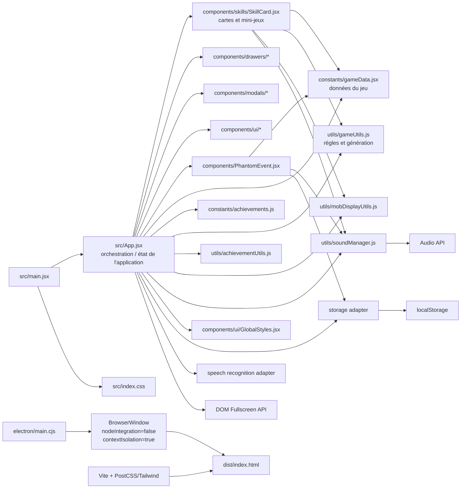

# Registre de dette technique — CodeWash

**État de référence :** 27 novembre 2026 (audit avant nettoyage)
**Périmètre observé :** application React/Vite et son lanceur Electron, dans `CodeWashGame/`.
**État des travaux :** le constat initial était documentaire et la couverture échouait aux seuils. DEBT-01 est maintenant résolu côté dépôt : tests de caractérisation ajoutés, workflow de packaging replacé et CI locale validée sans modification du comportement métier. La configuration de protection du check requis reste à confirmer dans GitHub Settings.

## 0. Provenance du code de référence

| Élément         | Valeur                                                                                                                            |
| --------------- | --------------------------------------------------------------------------------------------------------------------------------- |
| Archive reçue   | `CodeWashGame.tgz` (267 332 096 octets)                                                                                           |
| Format réel     | archive **tar POSIX non compressée** créée sur macOS, malgré l’extension `.tgz` (`file CodeWashGame.tgz`)                         |
| SHA-256         | `a6eee7a148b8a3e084944cc84c51b72ec2fa2d39edc2425505cbb13b56b8af30` (`sha256sum CodeWashGame.tgz`)                                 |
| Contenu importé | 286 fichiers sous `CodeWashGame/`, commités sans modification et tagués `v0-original`                                             |
| Exclusions      | 375 entrées `._*` (métadonnées AppleDouble macOS : attributs étendus, pas des fichiers du projet), volontairement non versionnées |
| Vérification    | `tar df CodeWashGame.tgz` ne signale aucune différence de contenu sur les fichiers importés                                       |
| Archive         | non versionnée (`*.tgz` dans `.gitignore`); à joindre à la GitHub Release `v0-original` si on veut la conserver                   |
| Git LFS         | non nécessaire : aucun fichier ne dépasse 50 Mo                                                                                   |

Ce registre décrit les dettes visibles dans le code et les écarts par rapport au protocole du sujet CodeWash. Les risques et estimations sont des évaluations initiales à confirmer avec l’équipe. Les mesures non exécutées sont signalées comme telles plutôt que supposées.

## 1. Cartographie de l’application

### Responsabilités et frontières observées

| Zone                                                                                     | Responsabilité actuelle                                                                                                                            |
| ---------------------------------------------------------------------------------------- | -------------------------------------------------------------------------------------------------------------------------------------------------- |
| `src/main.jsx`                                                                           | Point d'entrée React; monte `App` et importe le CSS global.                                                                                        |
| `src/App.jsx` (1 681 lignes)                                                             | État des profils et du joueur, persistance, progression, combats, succès, thèmes, événements, reconnaissance vocale et composition de l'interface. |
| `src/components/skills/SkillCard.jsx` (1 111 lignes)                                     | Présentation des compétences et logique/état de plusieurs mini-jeux (mémoire, Simon, lecture, écriture, calcul, nettoyage).                        |
| `src/components/drawers/*`, `modals/*`, `profile/*`, `ui/*`                              | Réglages, cosmétiques, menu, profils, confirmations et composants d'interface. `MenuDrawer_old.jsx` n'a pas d'import repéré dans `src/`.           |
| `src/constants/gameData.jsx`, `src/constants/achievements.js`, `src/constants/assets.js` | Données des compétences, thèmes, contenus, ennemis, objets, succès et chemins d'assets.                                                            |
| `src/utils/gameUtils.js`, `achievementUtils.js`, `mobDisplayUtils.js`                    | Règles de jeu, progression/succès et présentation de données.                                                                                      |
| `src/utils/soundManager.js`                                                              | Singleton de gestion de la musique et des sons; crée et joue directement les objets `Audio`.                                                       |
| `src/components/ui/GlobalStyles.jsx`, `src/index.css`                                    | Styles globaux, animations et CSS d'entrée.                                                                                                        |
| `electron/main.cjs`                                                                      | Cycle de vie Electron, création de la fenêtre et chargement de `dist/index.html`.                                                                  |
| `vite.config.js`, `postcss.config.js`, `tailwind.config.js`                              | Build/test/coverage Vitest, transformations React/Tailwind et configuration CSS.                                                                   |

### État et entrées/sorties

- **État React partagé :** concentré dans `App.jsx` (profil courant, statistiques, compétences, thème, combat, challenge, volumes, micro et panneaux); l'état des mini-jeux vit dans `SkillCard.jsx`. Les compteurs et refs de cycle de vie sont locaux aux composants.
- **Singletons/variables mutables :** `soundManager.js` conserve un gestionnaire de musique au niveau du module; `electron/main.cjs` conserve `mainWindow`. L'état d'application principal est partagé par props depuis `App`, pas par un store externe.
- **Fichiers et stockage :** les sauvegardes sont sérialisées en JSON via l'adaptateur injectable; seul celui-ci accède à `localStorage`. Electron charge `dist/index.html`; Vite génère `dist/`.
- **Parsing :** validation, compatibilité de versions et valeurs par défaut sont centralisées dans les modules de stockage; les clés et enveloppes JSON historiques restent identiques.
- **Audio :** la création et la lecture passent par `soundManager.js`, avec une fabrique injectable et un signalement observable des rejets.
- **Microphone :** l'adaptateur sélectionne `SpeechRecognition` standard ou son fallback `webkitSpeechRecognition`; le hook gère l'état et le nettoyage du cycle de vie.
- **Horloge/aléatoire/timers :** les règles et composants reçoivent des dépendances injectables avec des valeurs système par défaut; les temporisations possèdent un nettoyage au démontage ou au changement d'état.
- **DOM/OS :** API plein écran dans `App.jsx`; Electron utilise `BrowserWindow`, raccourcis clavier et cycle de vie de l'application.
- **Réseau :** le signalement de bogue utilise un endpoint HTTP multipart configurable; sans endpoint ou après échec réseau, il exporte localement un bundle JSON. Le serveur de réception reste à fournir/configurer par l'exploitation.

## 2. Registre des dettes

Les priorités sont définies ainsi : **P0** = prérequis bloquant avant refactoring, **P1** = risque élevé ou fonctionnalité importante, **P2** = amélioration à planifier. Les efforts sont des tailles indicatives : **S** (≤ 1 jour), **M** (2–5 jours), **L** (> 5 jours), à valider après découpage en tâches.

| ID      | Emplacement                                                                                                                                                                                                                                                                                                | Problème / odeur                                                                                                                                                                                                                                                                                                                                                                                                                                                                                                                                                                                                                                                                                     | Impact (1–3) | Risque / probabilité (1–3) | Effort | Priorité | Statut                                                                                                                                                                                                           |
| ------- | ---------------------------------------------------------------------------------------------------------------------------------------------------------------------------------------------------------------------------------------------------------------------------------------------------------- | ---------------------------------------------------------------------------------------------------------------------------------------------------------------------------------------------------------------------------------------------------------------------------------------------------------------------------------------------------------------------------------------------------------------------------------------------------------------------------------------------------------------------------------------------------------------------------------------------------------------------------------------------------------------------------------------------------- | -----------: | -------------------------: | ------ | -------- | ---------------------------------------------------------------------------------------------------------------------------------------------------------------------------------------------------------------- |
| DEBT-01 | `.github/workflows/ci.yml`, `.github/workflows/build-exe.yml`, `CodeWashGame/vite.config.js`, tests `src/**/*.test.{js,jsx}`                                                                                                                                                                                  | Baseline : `npm run test:coverage` échouait aux seuils (43 tests; lignes 16,64 %, statements 16,86 %, fonctions 18,68 %, branches 11,6 %). Des tests de caractérisation couvrent maintenant chargement/sauvegarde, profils, combat et UI sans changer le code métier; le contrôle complet passe avec les seuils inchangés. Le workflow de packaging a été déplacé de `CodeWashGame/.github/workflows/` vers le dossier racine reconnu par GitHub et ses chemins/versions d'outils ont été alignés. `main` est protégée. |            3 |                          3 | M      | P0       | **Resolved côté dépôt** — validation et mesures après travaux ci-dessous; action manuelle GitHub restante pour confirmer `quality-gate` comme check obligatoire. |
| DEBT-02 | [`src/App.jsx`](../CodeWashGame/src/App.jsx), `src/hooks/`, `src/utils/profileStorage.js`, `src/components/game/`                                                                                                                                                                                                | Monolithe de 1 681 lignes et cinq fonctions de complexité > 10; état, règles, stockage, parole et rendu étaient mêlés. Découpage en orchestration, hooks/services et vues testés; clés de stockage et comportements conservés.                                                                                                                                                                                                                                                                                                                                                                                                                                                                       |            3 |                          3 | L      | P1       | **Resolved** — voir mesures avant/après et ADR-001 ci-dessous.                                                                                                                                                    |
| DEBT-03 | [`src/components/skills/SkillCard.jsx`](../CodeWashGame/src/components/skills/SkillCard.jsx), `src/hooks/minigames/`, `src/utils/minigames/`, `src/components/skills/minigames/`                                                                                                                                 | L'état, les règles, les timers et le rendu des six mini-jeux étaient concentrés dans un composant monolithique. Les règles pures, l'orchestration temporisée et les vues sont maintenant séparées; l'API de `SkillCard` et les délais de jeu sont conservés.                                                                                                                                                                                                                                                                                                                                                                                                                                    |            3 |                          2 | L      | P1       | **Resolved** — voir mesures avant/après et ADR-002 ci-dessous.                                                                                                                                                    |
| DEBT-04 | [`src/utils/storage/`](../CodeWashGame/src/utils/storage/), [`src/utils/profileStorage.js`](../CodeWashGame/src/utils/profileStorage.js), [`src/hooks/useProfileState.js`](../CodeWashGame/src/hooks/useProfileState.js), [`src/hooks/useProfileActions.js`](../CodeWashGame/src/hooks/useProfileActions.js), [`src/components/PhantomEvent.jsx`](../CodeWashGame/src/components/PhantomEvent.jsx) | Les accès de stockage et parseurs JSON étaient distribués; `profileNames`/`parentStatus` n'étaient pas validés et `currentProfile` n'était pas borné. Un adaptateur injectable, les schémas de sauvegarde et la compatibilité des clés historiques sont maintenant centralisés; les formats valides restent inchangés.                                                                                                                                                                                                                                                                                                                                                                                     |            3 |                          2 | M      | P1       | **Resolved** — voir mesures avant/après et ADR-003 ci-dessous.                                                                                                                                                    |
| DEBT-05 | [`src/App.jsx`](../CodeWashGame/src/App.jsx), [`src/components/skills/SkillCard.jsx`](../CodeWashGame/src/components/skills/SkillCard.jsx), [`src/components/PhantomEvent.jsx`](../CodeWashGame/src/components/PhantomEvent.jsx), `src/hooks/minigames/`, [`src/hooks/useCombatActions.js`](../CodeWashGame/src/hooks/useCombatActions.js), [`src/hooks/useSpeechRecognition.js`](../CodeWashGame/src/hooks/useSpeechRecognition.js), `src/hooks/useAutoDismiss.js`, `src/utils/gameUtils.js`, `src/utils/mobDisplayUtils.js`, [`src/utils/soundManager.js`](../CodeWashGame/src/utils/soundManager.js), `src/utils/systemEffects.js`, `src/utils/speechRecognition.js` | Horloge, aléatoire, timers, audio et Web Speech sont désormais injectables/encapsulés; nettoyage des temporisations garanti; rejets audio observables et non bloquants.                                                                                                                                                                                                                                                                                                                                                                                                                                                                                                                   |            2 |                          3 | M      | P1       | **Resolved** — voir mesures avant/après et ADR-004 ci-dessous.                                                                                                                                                    |
| DEBT-06 | [`src/components/modals/BugReportModal.jsx`](../CodeWashGame/src/components/modals/BugReportModal.jsx), [`src/utils/bugReport/`](../CodeWashGame/src/utils/bugReport/), [`src/utils/diagnostics/`](../CodeWashGame/src/utils/diagnostics/), `src/components/game/GameChrome.jsx` | Le modal statique ne collectait ni n'envoyait de rapport. Le formulaire, la collecte opt-in, la validation des pièces jointes, le transport injectable et l'export local sont maintenant couverts par tests; destinataire et endpoint sont configurables sans valeur codée en dur.                                                                                                                                                                                                                                                                                                                                                 |            2 |                          2 | M      | P2       | **Resolved** — voir mesures avant/après et ADR-005 ci-dessous.                                                                                                                                                    |
| DEBT-07 | [`src/components/ui/GlobalStyles.jsx`](../CodeWashGame/src/components/ui/GlobalStyles.jsx) (1 302 lignes), [`src/constants/gameData.jsx`](../CodeWashGame/src/constants/gameData.jsx) (723 lignes)                                                                                                         | Styles/animations et données de jeu sont concentrés dans de gros modules; séparation données, présentation et comportement peu explicite.                                                                                                                                                                                                                                                                                                                                                                                                                                                                                                                                                            |            2 |                          2 | M      | P2       | **Open**                                                                                                                                                                                                         |
| DEBT-08 | [`src/components/drawers/MenuDrawer_old.jsx`](../CodeWashGame/src/components/drawers/MenuDrawer_old.jsx), `MenuDrawer.jsx`, `CosmeticsDrawer.jsx`, `ResetModal.jsx`, `ParentalVerificationModal.jsx`                                                                                                       | Le drawer historique n'a pas d'import repéré. jscpd détecte 11 groupes de clones, 206 lignes (3,99 %) et 1 662 tokens (3,86 %) dupliqués; les clones incluent les deux drawers, des blocs internes de `CosmeticsDrawer.jsx` et des modals similaires.                                                                                                                                                                                                                                                                                                                                                                                                                                                |            1 |                          2 | S–M    | P2       | **Open** — confirmer les usages, puis traiter séparément suppression et extraction des blocs.                                                                                                                    |
| DEBT-09 | [`src/utils/gameUtils.js`](../CodeWashGame/src/utils/gameUtils.js), `generateMathProblem`, cas `'-'`                                                                                                                                                                                                       | La soustraction peut générer `0 - 1 = -1` malgré le commentaire annonçant un résultat positif; cas conservé par un test `QUIRK`.                                                                                                                                                                                                                                                                                                                                                                                                                                                                                                                                                                     |            2 |                          2 | S      | P2       | **Open** — changement de règle pédagogique à décider explicitement.                                                                                                                                              |
| DEBT-10 | `CodeWashGame/package.json`, `CodeWashGame/package-lock.json`                                                                                                                                                                                                                                              | Les vulnérabilités npm Electron/empaquetage ont été corrigées : Electron 45.5.0, electron-builder 26.18.0 et overrides `minimatch` ciblés; audit actuel : 0 vulnérabilité. L'historique de validation est 8 → 0. Des avis de dépréciation transitifs non vulnérables ont été signalés précédemment.                                                                                                                                                                                                                                                                                                                                                                                                  |            2 |                          1 | M      | P1       | **Resolved**                                                                                                                                                                                                     |
| DEBT-11 | `CodeWashGame/package.json`, `CodeWashGame/package-lock.json`, `CodeWashGame/postcss.config.js`                                                                                                                                                                                                            | Optimisation à confirmer : 21 dépendances directes (3 runtime, 18 dev), aucune dépendance runtime mal classée n'a été repérée. `@types/react` et `@types/react-dom` sont les seuls candidats sans source TypeScript/TSX; ils peuvent servir à l'IntelliSense. Le lockfile contient 46 familles à versions multiples; la plupart semblent requises par des plages incompatibles ou des binaires natifs. `npm dedupe --dry-run` propose une déduplication de `ci-info` (4.5.0 → 4.3.1). Il a aussi affiché un avertissement de script d'installation en attente pour `electron-winstaller@5.4.0`, malgré l'entrée `allowScripts`; l'état d'approbation doit être confirmé lors d'un prochain `npm ci`. |            1 |                          2 | S      | P2       | **Open** — ne retirer/forcer aucun paquet avant vérification de l'usage et compatibilité.                                                                                                                        |
| DEBT-12 | [`src/App.jsx`](../CodeWashGame/src/App.jsx), [`src/utils/soundManager.js`](../CodeWashGame/src/utils/soundManager.js), [`electron/main.cjs`](../CodeWashGame/electron/main.cjs)                                                                                                                           | État applicatif centralisé dans le composant racine et gestionnaires mutables au niveau module (`soundManager`, `mainWindow`). L'état React est transmis par props, mais les singletons et les effets sont difficiles à isoler dans les tests.                                                                                                                                                                                                                                                                                                                                                                                                                                                       |            2 |                          2 | M      | P2       | **Open**                                                                                                                                                                                                         |

## 3. Mesures de référence avant nettoyage

Mesures exécutées le 27 novembre 2026 depuis `CodeWashGame/`. Aucune dépendance ni source n'a été modifiée pendant cet audit.

### 3.1 Commandes et résultats

| Mesure              | Commande exacte               | Résultat                                                                                                                                                                                                              |
| ------------------- | ----------------------------- | --------------------------------------------------------------------------------------------------------------------------------------------------------------------------------------------------------------------- |
| Tests fonctionnels  | `npm test`                    | Réussi : 3 fichiers, 43 tests.                                                                                                                                                                                        |
| Lint                | `npm run lint`                | Réussi : ESLint sans erreur ni avertissement.                                                                                                                                                                         |
| Format              | `npm run format:check`        | Réussi : tous les fichiers au format Prettier.                                                                                                                                                                        |
| Build               | `npm run build`               | Réussi : JS 362,79 kB (gzip 102,62 kB), CSS 61,80 kB (gzip 11,08 kB), HTML 0,49 kB (gzip 0,30 kB).                                                                                                                    |
| Couverture          | `npm run test:coverage`       | Les 43 tests passent, mais commande en échec sur les seuils : lignes 16,64 % (282/1 694), statements 16,86 % (308/1 826), fonctions 18,68 % (74/396), branches 11,6 % (153/1 318). Seuils configurés : 24/24/40/65 %. |
| Complexité          | `npm run metrics:complexity`  | 0 erreur, 14 avertissements au-dessus de 10.                                                                                                                                                                          |
| Duplication         | `npm run metrics:duplication` | 11 groupes de clones, 206/5 167 lignes analysées (3,99 %), 1 662/43 087 tokens (3,86 %).                                                                                                                              |
| Vulnérabilités      | `npm audit`                   | 0 vulnérabilité.                                                                                                                                                                                                      |
| Installation propre | `npm ci`                      | Réussie lors de la validation des dépendances précédente; non relancée dans cet audit, car aucun manifeste n'a changé.                                                                                                |

Le rapport de couverture montre notamment `App.jsx`, les drawers, les modals, les composants UI, `SkillCard.jsx` et `soundManager.js` à 0 %. Les tests existants couvrent surtout les fonctions utilitaires pures et les modules de données.

### 3.2 Lignes par fichier

Commandes exactes : `find src electron -type f \( -name '*.js' -o -name '*.jsx' -o -name '*.cjs' -o -name '*.css' \) -print0 | sort -z | xargs -0 wc -l` et `wc -l package.json vite.config.js eslint.config.js postcss.config.js tailwind.config.js index.html`. `src/` contient 28 fichiers et 8 594 lignes physiques; avec `electron/main.cjs`, total 8 650 lignes.

| Fichier                                     | Lignes | Fichier                                           | Lignes |
| ------------------------------------------- | -----: | ------------------------------------------------- | -----: |
| `src/App.jsx`                               |  1 681 | `src/components/drawers/CosmeticsDrawer.jsx`      |    373 |
| `src/components/drawers/MenuDrawer.jsx`     |    320 | `src/components/drawers/MenuDrawer_old.jsx`       |    262 |
| `src/components/drawers/SettingsDrawer.jsx` |    118 | `src/components/modals/BugReportModal.jsx`        |     21 |
| `src/components/modals/ResetModal.jsx`      |    121 | `src/components/PhantomEvent.jsx`                 |    150 |
| `src/components/profile/ProfileCard.jsx`    |    212 | `src/components/skills/SkillCard.jsx`             |  1 111 |
| `src/components/ui/AchievementToast.jsx`    |     74 | `src/components/ui/GlobalStyles.jsx`              |  1 302 |
| `src/components/ui/MobWithAura.jsx`         |     65 | `src/components/ui/ParentalVerificationModal.jsx` |    132 |
| `src/components/ui/PixelHeart.jsx`          |     98 | `src/components/ui/SafeImage.jsx`                 |     25 |
| `src/constants/achievements.js`             |    345 | `src/constants/assets.js`                         |     37 |
| `src/constants/gameData.jsx`                |    723 | `src/index.css`                                   |     54 |
| `src/main.jsx`                              |     10 | `src/utils/achievementUtils.js`                   |    217 |
| `src/utils/achievementUtils.test.js`        |    138 | `src/utils/gameUtils.js`                          |    382 |
| `src/utils/gameUtils.test.js`               |    271 | `src/utils/mobDisplayUtils.js`                    |     42 |
| `src/utils/mobDisplayUtils.test.js`         |     25 | `src/utils/soundManager.js`                       |    285 |
| `electron/main.cjs`                         |     56 |                                                   |        |

Fichiers de configuration/manifest supplémentaires : `package.json` 100 lignes, `vite.config.js` 33, `eslint.config.js` 25, `postcss.config.js` 6, `tailwind.config.js` 43, `index.html` 13. Le lockfile fait 8 270 lignes.

### 3.3 Dépendances npm

**Commandes :** `npm audit`; `npm ls --depth=0`; `npm dedupe --dry-run`; lecture croisée des imports `src/`, configurations et scripts npm. `depcheck` n'est pas installé et aucun outil n'a été ajouté pour cet audit.

- Dépendances directes : **21** (3 `dependencies`, 18 `devDependencies`). Les trois runtime (`react`, `react-dom`, `lucide-react`) sont importées par l'application. Les dépendances de build, lint, test, couverture, formatage et métriques sont en `devDependencies`; `electron` est utilisé par le lanceur et les scripts, `electron-builder` par le script et la configuration de packaging.
- Les configurations confirment l'usage de `@vitejs/plugin-react`, `@tailwindcss/postcss`, `autoprefixer`, `postcss`, des plugins ESLint, Vitest, `@vitest/coverage-v8`, jscpd, Prettier, Electron et electron-builder.
- `@types/react` et `@types/react-dom` ne sont pas consommés par des sources `.ts/.tsx` (aucune trouvée); ils restent des candidats à retirer seulement si l'équipe ne dépend pas de leurs complétions JavaScript dans l'éditeur.
- Le lockfile contient **609 entrées `node_modules/`, 513 noms de paquets et 46 familles avec plusieurs versions**. Les versions multiples ne sont pas toutes redondantes : plusieurs respectent des plages majeures incompatibles ou correspondent aux binaires natifs de Lightning CSS. Le dry-run ne propose qu'une consolidation de `ci-info` sous `electron-builder`; aucun `npm dedupe` réel n'a été lancé.
- `npm audit` ne signale aucune vulnérabilité. Les avis de dépréciation transitifs précédemment vus (`glob`, `rimraf`, `inflight`, `boolean`) ne sont pas des vulnérabilités et aucun override global n'est justifié par cette mesure.

| Catégorie           | Paquets directs                                                                                           | Usage / classement                                                                                    |
| ------------------- | --------------------------------------------------------------------------------------------------------- | ----------------------------------------------------------------------------------------------------- |
| Runtime             | `react`, `react-dom`, `lucide-react`                                                                      | Importés par l'application; classement `dependencies` cohérent.                                       |
| Build et CSS        | `@vitejs/plugin-react`, `@tailwindcss/postcss`, `autoprefixer`, `postcss`, `vite` (`rolldown-vite@7.2.5`) | Configurations Vite/PostCSS/Tailwind et scripts de build; classement `devDependencies` cohérent.      |
| Electron            | `electron`, `electron-builder`                                                                            | Lanceur/app de bureau et script `electron:build`; classement `devDependencies` cohérent.              |
| Lint                | `@eslint/js`, `eslint`, `eslint-plugin-react-hooks`, `eslint-plugin-react-refresh`, `globals`             | Importés/référencés par `eslint.config.js`; classement `devDependencies` cohérent.                    |
| Tests et couverture | `vitest`, `@vitest/coverage-v8`                                                                           | Scripts npm, tests et configuration de couverture; classement `devDependencies` cohérent.             |
| Qualité             | `prettier`, `jscpd`                                                                                       | Scripts de format et métriques; classement `devDependencies` cohérent.                                |
| Types à confirmer   | `@types/react`, `@types/react-dom`                                                                        | Pas de source TypeScript/TSX; candidats de nettoyage seulement après confirmation de l'usage éditeur. |

Exemples de familles multi-version du lockfile : `minimatch` (3/5/11, versions utilisées par des branches de dépendances différentes et overrides ciblés), `semver` (5/6/7), `fs-extra` (7 à 11) et `lightningcss` (1.30/1.33, avec variantes natives). Ces répétitions ne prouvent pas à elles seules une dépendance inutile; seul `ci-info` ressort comme candidat concret du dry-run.

### 3.4 Complexité cyclomatique

Outil : ESLint `complexity` (seuil 10), `npm run metrics:complexity`. **14 fonctions** dépassent 10. Les plus complexes :

| Complexité | Emplacement                                                                   |
| ---------: | ----------------------------------------------------------------------------- |
|        107 | `src/components/skills/SkillCard.jsx:97`                                      |
|         31 | `src/App.jsx:134`                                                             |
|         27 | `src/components/drawers/MenuDrawer.jsx:174`                                   |
|         24 | `src/App.jsx:614`                                                             |
|         21 | `src/components/drawers/CosmeticsDrawer.jsx:140`                              |
|         17 | `src/App.jsx:486`                                                             |
|         16 | `src/App.jsx:79`, `src/App.jsx:1523`                                          |
|         15 | `src/components/drawers/CosmeticsDrawer.jsx:268`, `src/utils/gameUtils.js:47` |

### 3.5 Duplication

Outil : jscpd 4.0.5, clones ≥ 50 tokens, tests exclus, `npm run metrics:duplication`.

| Format     | Fichiers analysés | Lignes analysées | Clones | Lignes dupliquées |   Tokens dupliqués |
| ---------- | ----------------: | ---------------: | -----: | ----------------: | -----------------: |
| JavaScript |                19 |            2 425 |      1 |       31 (1,28 %) |       215 (1,11 %) |
| JSX        |                15 |            2 689 |     10 |      175 (6,51 %) |     1 447 (6,17 %) |
| CSS        |                 1 |               53 |      0 |                 0 |                  0 |
| **Total**  |            **35** |        **5 167** | **11** |  **206 (3,99 %)** | **1 662 (3,86 %)** |

Clones détectés : `MenuDrawer.jsx` ↔ `MenuDrawer_old.jsx`, trois zones de `CosmeticsDrawer.jsx`, deux modals (`ResetModal.jsx` / `ParentalVerificationModal.jsx`) et des blocs de réglages. Comparer les mêmes périmètres et commandes avant/après tout refactoring.

## 4. Matrice de risque initiale (avant correction)

Échelle qualitative : impact et probabilité de 1 (faible) à 3 (fort). Le produit Impact × Probabilité détermine la priorité indicative; il ne représente pas une fréquence observée.

| Dette                                                        | Impact | Probabilité | Produit | Niveau       | Justification                                                                                             |
| ------------------------------------------------------------ | -----: | ----------: | ------: | ------------ | --------------------------------------------------------------------------------------------------------- |
| DEBT-01 — seuils de couverture bloquants                     |      3 |           3 |       9 | **Traité**   | Risque initial : couverture sous les seuils et workflow de packaging non reconnu; voir la résolution ci-dessous. |
| DEBT-02 — orchestration concentrée dans `App.jsx`            |      3 |           3 |       9 | **Résolu**   | Le composant a été réduit à 472 lignes; les responsabilités extraites sont couvertes par des tests.       |
| DEBT-03 — mini-jeux concentrés dans `SkillCard.jsx`          |      3 |           2 |       6 | **Résolu**   | Les règles, timers et vues des six jeux sont séparés et couverts; le composant d'origine fait 138 lignes. |
| DEBT-04 — persistance et parsing inline                      |      3 |           2 |       6 | **Élevé**    | Les sauvegardes sont persistantes et leur validation/migration est dispersée.                             |
| DEBT-05 — effets système non isolés / erreurs audio masquées |      2 |           3 |       6 | **Élevé**    | Horloge, aléatoire, timers, audio et microphone varient selon navigateur/périphérique.                    |
| DEBT-06 — rapport de bogue inactif                           |      2 |           2 |       4 | **Résolu**   | Le formulaire configurable transmet via multipart ou exporte un bundle local après consentement explicite. |
| DEBT-07 — styles et données volumineux                       |      2 |           2 |       4 | **Modéré**   | Les changements de thème et d'interface sont plus coûteux à relire.                                       |
| DEBT-08 — duplication et ancien drawer                       |      1 |           2 |       2 | **Faible**   | Coût de maintenance; aucune dépendance fonctionnelle à l'ancien fichier n'est repérée.                    |
| DEBT-09 — soustraction pouvant produire un négatif           |      2 |           2 |       4 | **Modéré**   | Contenu pédagogique incohérent possible, comportement actuel caractérisé.                                 |
| DEBT-10 — vulnérabilités npm/Electron                        |      2 |           1 |       2 | **Résolu**   | `npm audit` retourne 0 vulnérabilité après mise à niveau et overrides ciblés.                             |
| DEBT-11 — optimisation/déduplication npm                     |      1 |           2 |       2 | **Faible**   | Quelques candidats sont à confirmer; les dépendances transitives ne doivent pas être forcées sans preuve. |
| DEBT-12 — état et singletons mutables                        |      2 |           2 |       4 | **Modéré**   | Concentration des responsabilités et dépendances implicites compliquent l'isolation des tests.            |

## 5. Plan d’attaque proposé

1. **Rendre la CI réellement verte (DEBT-01, résolu côté dépôt).** Tests ciblés ajoutés et seuils conservés; workflow de packaging replacé. Vérifier manuellement que `quality-gate` est requis dans la règle de protection GitHub.
2. **Sécuriser les sauvegardes sans casser les données (DEBT-04, DEBT-12).** Caractériser le format `localStorage`, couvrir les parseurs, puis isoler validation/versionnement et accès au stockage. Préserver les clés, valeurs et migrations existantes.
3. **Isoler les effets de bord observés (DEBT-05).** Encapsuler progressivement horloge, aléatoire, timers, audio et reconnaissance vocale; remplacer les catches silencieux par un comportement observable sans dégrader l'expérience sonore.
4. **Découper les gros composants (DEBT-02 et DEBT-03 résolus; DEBT-07 ouvert).** `App.jsx` et `SkillCard.jsx` sont séparés en orchestration, hooks, règles et vues, sans modifier les contrats publics, la progression, les commandes ou le rendu. Le découpage des styles et des données reste à planifier.
5. **Réduire les coûts de maintenance (DEBT-08, DEBT-11).** Vérifier les dépendances de `MenuDrawer_old.jsx`, traiter les blocs dupliqués et confirmer l'usage des types. Ne lancer ni `npm dedupe` ni override de dépendance sans relire le diff du lockfile et revalider Electron.
6. **Décisions produit et suivi.** Maintenir le destinataire et le serveur du rapport configurés pour chaque distribution (DEBT-06 résolu); planifier la règle de soustraction séparément (DEBT-09); conserver `npm audit` à 0 (DEBT-10).
7. **Mesurer et transmettre.** Reprendre les mêmes commandes après chaque étape, consigner les résultats et ne déclarer la CI verte qu'après un run réussi.

**Contrats à préserver pendant les travaux :** progression, difficulté et récompenses des compétences; comportement des profils et compatibilité des sauvegardes; parcours et commandes clavier/souris des mini-jeux; prise en charge vocale lorsqu’elle existe et comportement de repli lorsqu’elle n’existe pas; rendu des thèmes et lancement browser/Electron.

## 6. Traitement de DEBT-01 — validation locale et état final

Les nouveaux tests sont des tests de caractérisation; aucun code métier n'a été changé. Le seul hook d'installation ajouté invoque l'installateur officiel Electron 45.5.0, car le paquet publié ne déclare pas de script `postinstall`. Il respecte `ELECTRON_SKIP_BINARY_DOWNLOAD=1` pour le job qualité. Les autorisations `allowScripts` restent limitées à `electron@45.5.0` et `electron-winstaller@5.4.0`.

### Couverture avant / après

| Métrique | Avant (43 tests) | Après (65 tests) | Seuil conservé |
|---|---:|---:|---:|
| Lignes | 16,64 % (282/1 694) | 72,19 % (1 223/1 694) | 24 % |
| Statements | 16,86 % (308/1 826) | 71,46 % (1 305/1 826) | 24 % |
| Fonctions | 18,68 % (74/396) | 65,90 % (261/396) | 40 % |
| Branches | 11,60 % (153/1 318) | 66,38 % (875/1 318) | 65 % |

### Couverture des périmètres caractérisés

Les métriques sont celles des fichiers instrumentés par Vitest; le rapport ne sépare pas les fonctions de chargement, de sauvegarde et de profils à l'intérieur de `App.jsx`.

| Périmètre / module | Lignes | Statements | Fonctions | Branches |
|---|---:|---:|---:|---:|
| Chargement / sauvegarde — `src/App.jsx` | 63,98 % | 62,92 % | 54,81 % | 55,88 % |
| Profils — `src/App.jsx` (même module) | 63,98 % | 62,92 % | 54,81 % | 55,88 % |
| Combat — `src/App.jsx` | 63,98 % | 62,92 % | 54,81 % | 55,88 % |
| Combat — `src/components/skills/SkillCard.jsx` | 48,78 % | 47,10 % | 32,78 % | 51,85 % |
| UI — `src/components/ui/` | 96,42 % | 96,62 % | 94,73 % | 93,84 % |
| UI — `src/components/drawers/CosmeticsDrawer.jsx` | 91,89 % | 92,10 % | 90,90 % | 94,25 % |
| UI — `src/components/drawers/MenuDrawer.jsx` | 100 % | 100 % | 100 % | 97,10 % |
| Profils / UI — `src/components/profile/ProfileCard.jsx` | 96,07 % | 89,65 % | 87,50 % | 81,13 % |
| Audio — `src/utils/soundManager.js` | 100 % | 100 % | 81,81 % | 96,15 % |

### Commandes de validation et état GitHub

Exécutées depuis `CodeWashGame/` avec npm 11.4.2 : `npm ci` (641 paquets installés, Electron inclus), `npm audit` (0 vulnérabilité), `npm run lint`, `npm run format:check`, `npm run test:coverage` (6 fichiers, 65 tests, tous seuils atteints), `npm run build` et `npm run metrics:complexity` (0 erreur; avertissements de complexité informatifs). `node_modules/.bin/electron --version` retourne `v45.5.0`. `npm run electron:dev -- --ozone-platform=x11` a construit l'application et maintenu le processus Electron/renderer actif. Le lancement sans option a aussi démarré, avec un avertissement Wayland/Vulkan propre à cet environnement.

L'API GitHub liste `main` comme protégée et ne liste pas de branche `develop`. Le workflow CI couvre toutes les pull requests et les pushs sur `main`; le packaging Windows couvre les pushs `main` et `workflow_dispatch`. Le workflow de packaging est désormais à `.github/workflows/build-exe.yml`, avec `working-directory: CodeWashGame`, Node 22, npm 11.4.2 et les chemins d'artefacts relatifs au dépôt. L'API disponible ne révèle pas les checks obligatoires : une vérification manuelle reste requise dans **Settings > Branches > Branch protection rules** pour confirmer que `quality-gate` bloque bien le merge.

## 7. Traitement de DEBT-02 — découpage d'`App.jsx`

Le découpage est terminé sans changement des règles de progression, des clés/formats `localStorage`, des commandes de mini-jeux, du repli Web Speech API ou du rendu des thèmes. La persistance des profils est regroupée dans `profileStorage.js` et `useProfileState`; les actions profil, combat, progression et parole sont isolées dans des hooks; le HUD, le carrousel et les overlays sont des vues dédiées. Voir [ADR-001](./adr/ADR-001-decouple-app-monolith.md).

### Mesures avant / après

| Mesure | Avant DEBT-02 | Après DEBT-02 |
|---|---:|---:|
| `App.jsx` — lignes | 1 681 | 472 |
| Fonctions d'`App.jsx` avec complexité > 10 | 5 (maximum 31) | 0 |
| Couverture `App.jsx` — lignes / statements / fonctions / branches | 63,98 % / 62,92 % / 54,81 % / 55,88 % | 100 % / 96,40 % / 90,90 % / 79,03 % |
| Couverture globale — lignes / statements / fonctions / branches | 72,19 % / 71,46 % / 65,90 % / 66,38 % (65 tests) | 90,12 % / 89,46 % / 85,42 % / 81,87 % (99 tests) |
| Duplication — clones / lignes / tokens | 11 / 206 (3,99 %) / 1 662 (3,86 %) | 14 / 257 (2,76 %) / 1 971 (2,34 %) |

La duplication est mesurée par `npm run metrics:duplication`. Les dénominateurs et l'ensemble des fichiers ont évolué avec le découpage; la commande exclut les `*.test.js` mais inclut les `*.test.jsx`, comme le montre la sortie. À la clôture de DEBT-02, neuf avertissements de complexité restaient dans le dépôt, dont celui de `SkillCard.jsx`, désormais traité par DEBT-03. Après DEBT-03, les sept avertissements restants concernent d'autres composants/utilitaires; aucune fonction d'`App.jsx` ou des modules extraits ne dépasse 10.

### Couverture lignes des modules extraits

| Module | Couverture lignes |
|---|---:|
| `src/hooks/useSpeechRecognition.js` | 100 % |
| `src/hooks/useProfileState.js` | 100 % |
| `src/hooks/useProfileActions.js` | 100 % |
| `src/hooks/useCombatActions.js` | 100 % |
| `src/hooks/gameActions.js` | 100 % |
| `src/utils/profileStorage.js` | 100 % |
| `src/components/game/GameChrome.jsx` | 100 % |
| `src/components/game/SkillCarousel.jsx` | 100 % |
| `src/components/game/GameOverlays.jsx` | 100 % |

La validation finale depuis `CodeWashGame/` passe : `npm test` (15 fichiers, 99 tests), `npm run test:coverage` (seuils d'origine conservés), `npm run lint`, `npm run format:check`, `npm run build`, `npm run metrics:complexity` (avertissements informatifs préexistants uniquement) et `npm run metrics:duplication`. `npm run electron:dev -- --ozone-platform=x11` a démarré le build et le processus Electron, qui est resté actif jusqu'à l'expiration contrôlée du smoke test (30 s).

## 8. Traitement de DEBT-03 — découpage des mini-jeux de `SkillCard`

Le découpage est terminé sans changement des props publiques de `SkillCard`, des règles de progression/scoring, des classes de présentation ni des séquences et délais des six mini-jeux. Les calculs de réponses, les règles mémoire/Simon et les styles de carte sont isolés dans des utilitaires purs; `useSkillCardMiniGames` orchestre états et effets; `useManagedTimers` annule les transitions au changement de combat et au démontage. Les vues des cartes, défis, jeux, contrôles et panneau de combat sont extraites sous `components/skills/`. Voir [ADR-002](./adr/ADR-002-modularize-skillcard-minigames.md).

### Mesures avant / après

| Mesure | Avant DEBT-03 (Pre-wash mesuré) | Après DEBT-03 |
|---|---:|---:|
| `SkillCard.jsx` — lignes | 1 111 | 138 |
| Fonctions de `SkillCard.jsx` avec complexité > 10 | 2 (107 et 13) | 0 |
| Couverture `SkillCard.jsx` — lignes / statements / fonctions / branches | 90,90 % / 90,75 % / 85,24 % / 80,13 % | 94,44 % / 94,44 % / 50 % / 68,75 % |
| Couverture globale — lignes / statements / fonctions / branches | 94,88 % / 94,04 % / 89,29 % / 84,99 % | 96,69 % / 95,71 % / 90,72 % / 87,64 % |
| Couverture lignes des nouveaux modules | — | 100 % sur chacun des 19 modules de règles, hooks et présentation |
| Duplication — clones / lignes / tokens | 15 / 263 (2,76 %) / 2 037 (2,35 %) | 15 / 263 (2,22 %) / 2 037 (1,89 %) |

La consigne de référence indiquait une couverture initiale de `SkillCard.jsx` de 48,78 % lignes, 47,10 % statements, 32,78 % fonctions et 51,85 % branches. Le Pre-wash a d'abord ajouté les tests de caractérisation; juste avant le refactoring, les mesures observées avaient donc déjà atteint les valeurs « Avant DEBT-03 » ci-dessus. Les seuils de couverture et les règles de lint/format n'ont pas été modifiés. Le résultat de `npm run metrics:complexity` ne contient plus d'avertissement pour `SkillCard.jsx` ni pour les modules extraits; sept avertissements préexistants demeurent dans d'autres composants/utilitaires.

### Validation finale

Depuis `CodeWashGame/` : `npm test` (126 tests, 22 fichiers), `npm run test:coverage` (mêmes 126 tests; couverture globale 96,69 % lignes), `npm run lint`, `npm run format:check`, `npm run build`, `npm run metrics:complexity` et `npm run metrics:duplication`. Les contrôles passent; les sept avertissements de complexité restants sont hors périmètre et aucun seuil n'a été abaissé. `timeout 30s npm run electron:dev -- --ozone-platform=x11` a construit le renderer et maintenu le processus Electron actif jusqu'à l'arrêt contrôlé par timeout.

## 9. Traitement de DEBT-04 — stockage et validation des sauvegardes

Les appels directs au stockage sont remplacés par un adaptateur injectable qui journalise explicitement les erreurs d'accès, de sérialisation et de quota. Les clés existantes (`heroSkills_v23_pN`, `heroSkills_v23`, `currentProfile_v1`, `heroProfileNames_v1`, `heroParentStatus_v1`, `borderEffect_pN`, `borderColor_pN` et `phantomEvent_lastSpawn_v1`) ainsi que l'enveloppe JSON `{ skills, theme, stats }` n'ont pas changé. Le chargement accepte toujours les sauvegardes de profil historiques et fusionne les statistiques partielles; les nouvelles validations écartent les données de schéma invalide vers les valeurs par défaut. Les champs inconnus de statistiques et les métadonnées valides partielles restent conservés.

### Mesures avant / après

| Mesure | Avant DEBT-04 | Après DEBT-04 |
|---|---:|---:|
| Appels directs `localStorage.getItem` / `setItem` / `removeItem` en production | 22 | 0 (encapsulés par l'adaptateur) |
| Sites `JSON.parse` dispersés en production | 8 | 1, centralisé dans l'adaptateur |
| Parseurs non validés hors adaptateur | 8 sites (dont les métadonnées de profil) | 0 |
| Couverture globale — lignes / statements / fonctions / branches | 96,69 % / 95,71 % / 90,72 % / 87,64 % | 96,77 % / 95,88 % / 91,26 % / 88,37 % |
| Couverture lignes / statements de `profileStorage.js` | 100 % / 99,20 % | 98,29 % / 98,02 % |
| Couverture lignes de `storageAdapter.js` | — | 100 % |
| Couverture lignes de `profileRepository.js` | — | 100 % |
| Couverture lignes de `profileSchemas.js` | — | 100 % |
| Tests / fichiers de test | 126 / 22 | 164 / 26 |

Le format est figé par des tests de caractérisation des clés et sérialisations exactes, des profils historiques, des données partielles, des JSON corrompus/tronqués, des identifiants hors plage et des échecs de quota. Les seuils de couverture et les configurations de lint/format n'ont pas été modifiés. Les trois nouveaux modules de stockage ont 100 % de couverture lignes, statements, fonctions et branches.

La validation finale depuis `CodeWashGame/` passe : `npm test` et `npm run test:coverage` (164 tests, 26 fichiers), `npm run lint`, `npm run format:check`, `npm run build`, `npm run metrics:complexity` et `npm run metrics:duplication`. Le résultat de complexité conserve sept avertissements préexistants hors périmètre. Le smoke test `timeout 30s npm run electron:dev -- --ozone-platform=x11` a démarré Electron et l'a maintenu actif jusqu'à l'arrêt contrôlé après 30 secondes. Voir [ADR-003](./adr/ADR-003-centralize-storage-and-schema-validation.md).

## 10. Traitement de DEBT-05 — effets système

Les appels d'horloge, d'aléatoire et de timers utilisent des dépendances injectables avec des valeurs système par défaut. Les timers React sont suivis et nettoyés au démontage ou lorsque leur état devient inactif. La fabrique audio et le gestionnaire sont centralisés; les rejets de `play()` sont journalisés et les callbacks d'erreur ne bloquent pas l'interface. L'adaptateur vocal préfère `SpeechRecognition`, puis utilise `webkitSpeechRecognition` en fallback; les redémarrages différés et l'instance active sont nettoyés au démontage.

### Mesures avant / après

| Mesure en production | Avant DEBT-05 | Après DEBT-05 |
|---|---:|---:|
| Appels `Date.now()` épars | 2 | 0 (1 défaut dans l'adaptateur d'horloge) |
| Appels `Math.random()` épars | 31 | 0 (1 défaut dans l'adaptateur aléatoire) |
| `new Audio()` | 11 | 0 hors gestionnaire (1 fabrique par défaut dans `soundManager.js`) |
| Références directes à `webkitSpeechRecognition` | 4 | 0 hors adaptateur (fallback encapsulé) |
| `.catch(() => {})` silencieux | 11 | 0 |
| Appels globaux `setTimeout()` épars | 17 | 0 (1 défaut dans le scheduler système) |
| Couverture globale — lignes / statements / fonctions / branches | 96,77 % / 95,88 % / 91,26 % / 88,37 % | 97,29 % / 96,31 % / 94,12 % / 88,96 % |
| Couverture lignes / statements / fonctions / branches des nouveaux modules | — | 100 % chacun : `systemEffects.js`, `speechRecognition.js`, `useAutoDismiss.js` |
| Duplication — clones / lignes / tokens | 15 / 263 (2,22 %) / 2 037 (1,89 %) | 15 / 263 (2,10 %) / 2 037 (1,75 %) |
| Tests / fichiers de test | 164 / 26 | 182 / 29 |

Les compteurs « épars » excluent les implémentations système par défaut conservées dans leurs adaptateurs. Les seuils de couverture et les configurations ESLint/Prettier n'ont pas été modifiés. Les quality gates passent; `metrics:complexity` conserve sept avertissements dans des fonctions préexistantes hors périmètre. Le smoke test `timeout 30s npm run electron:dev -- --ozone-platform=x11` a construit l'application et maintenu Electron actif jusqu'à son arrêt contrôlé par timeout. Voir [ADR-004](./adr/ADR-004-isolate-system-side-effects.md).

## 11. Traitement de DEBT-06 — signalement de bogues

Le modal conserve son contrat d'ouverture/fermeture depuis `GameChrome`, mais collecte maintenant une description, des captures et fichiers autorisés, ainsi qu'un aperçu préalable. Les données de sauvegarde et les diagnostics sont optionnels et désactivés par défaut. Les diagnostics sont conservés dans un buffer borné à 50 entrées; les erreurs runtime, de stockage et audio y sont enregistrées sans pile d'appel ni données de profil. Les valeurs ressemblant à des identifiants courants et les paramètres de requête des URL sont masqués dans les messages.

Le destinataire `VITE_BUG_REPORT_CONTACT` et le endpoint `VITE_BUG_REPORT_ENDPOINT` sont configurables à la compilation. Le transport HTTP injectable envoie un `multipart/form-data`; si aucun endpoint n'est configuré ou si le serveur échoue, l'application exporte un JSON local complet. Sans endpoint, le rapport n'est pas présenté comme reçu par un destinataire. Voir [ADR-005](./adr/ADR-005-bug-reporting-transport-and-privacy.md) et la section « Signaler un bogue » du README.

### Mesures avant / après

| Mesure | Avant DEBT-06 | Après DEBT-06 |
|---|---:|---:|
| Modal de signalement | 21 lignes, contenu statique, aucune collecte/envoi | Formulaire, aperçu, consentements facultatifs, envoi/fallback testés |
| Contact et endpoint configurables | Aucun | `VITE_BUG_REPORT_CONTACT` et `VITE_BUG_REPORT_ENDPOINT`; aucune destination codée en dur |
| Validation des pièces jointes | Aucune | 10 fichiers maximum, 5 Mio par fichier, 15 Mio au total; images/documents/textes autorisés |
| Diagnostics inclus par défaut | Aucun buffer ou signalement structuré | Non; opt-in séparé, buffer limité à 50 entrées |
| Couverture globale — lignes / statements / fonctions / branches | 97,29 % / 96,31 % / 94,12 % / 88,96 % | 97,60 % / 96,74 % / 94,87 % / 90,35 % |
| Couverture lignes des nouveaux modules de signalement/diagnostic | — | 100 % : modal, collecteur, service, validateur, transport HTTP/export, buffer de diagnostics |
| Complexité cyclomatique > 10 dans le nouveau code | — | 0; les sept avertissements mesurés sont préexistants et hors périmètre |
| Tests / fichiers de test | 182 / 29 | 206 / 34 |

Les seuils globaux et les configurations ESLint/Prettier n'ont pas été modifiés. Les tests couvrent les livraisons multipart et locales, la protection de la vie privée, les limites/type de fichiers, les erreurs de transport/export, l'ouverture/fermeture du modal et l'intégration menu → diagnostic. Le README documente le schéma attendu par le backend; aucun backend n'est fourni par ce dépôt.
